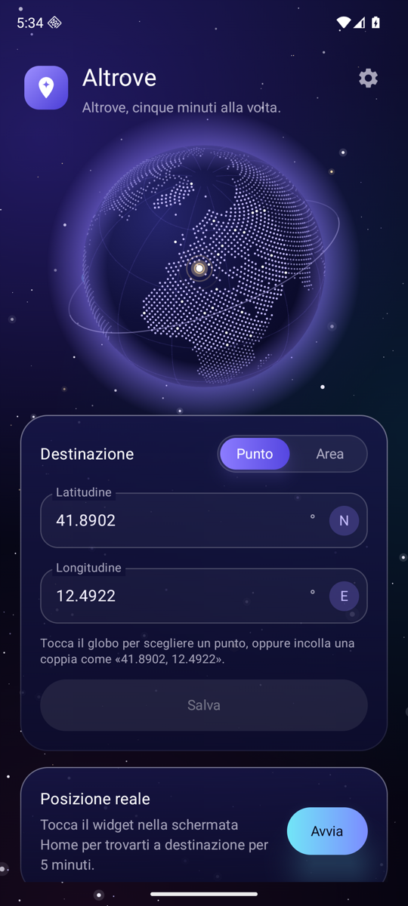
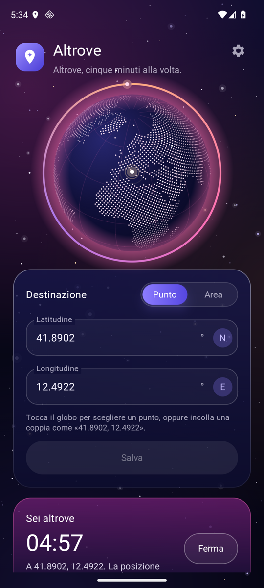
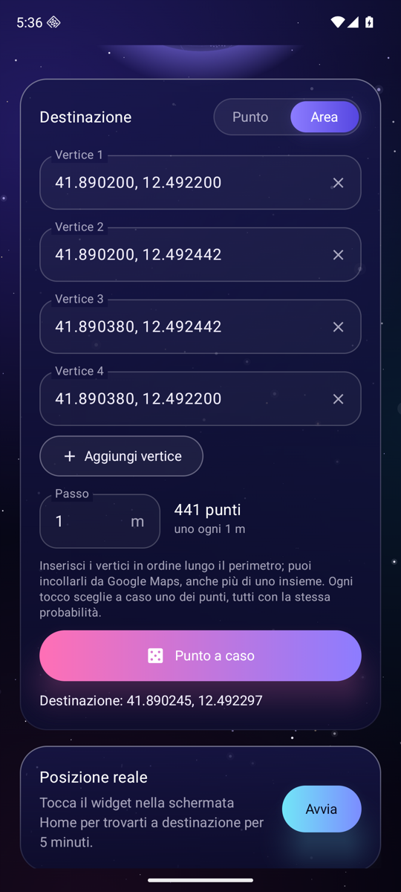
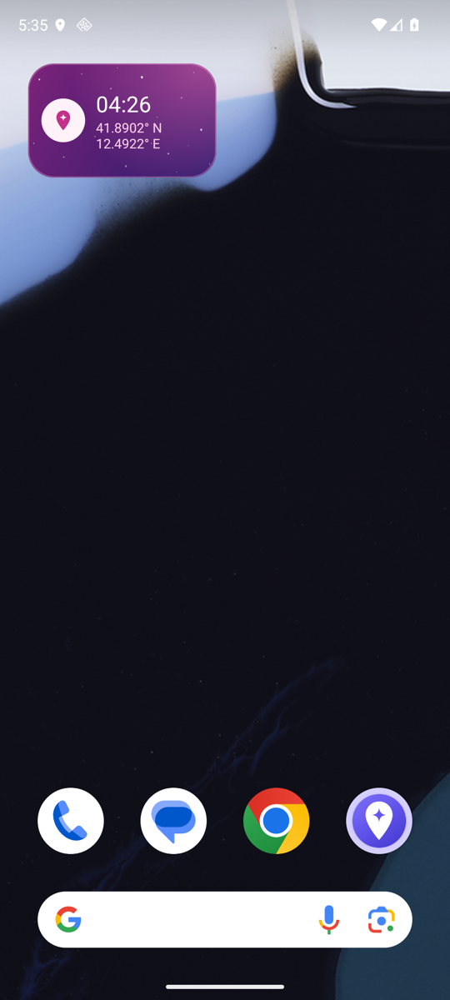
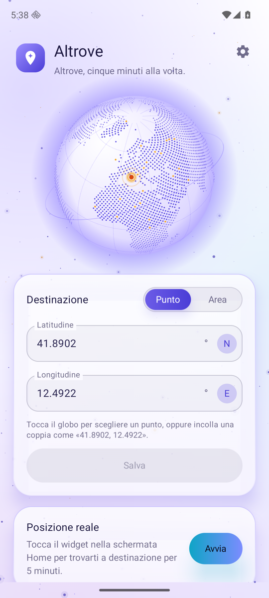
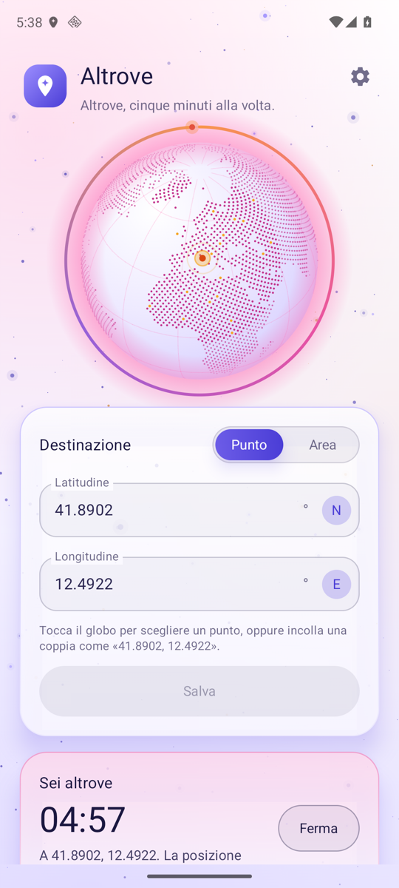
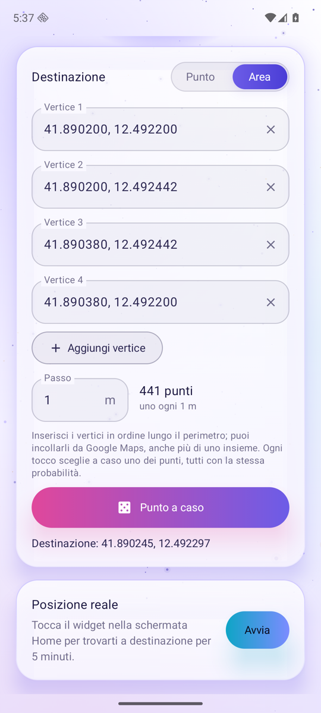
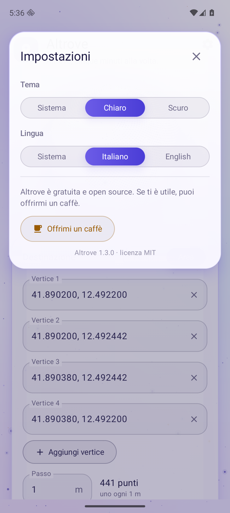

<div align="center">


# Altrove

**Altrove, cinque minuti alla volta.**

Un widget per Android che sposta la tua posizione GPS dove vuoi tu per esattamente 5 minuti, poi rimette quella vera da solo.<br/>
Un tocco e sei *altrove*.

<a href="https://github.com/Perruzz/Altrove/releases/latest/download/Altrove.apk">
  
</a>

<br/><br/>

[](https://github.com/Perruzz/Altrove/releases/latest)
[](https://github.com/Perruzz/Altrove/actions/workflows/android.yml)


[](LICENSE)

</div>

---

<div align="center">
<table>
  <tr>
    <td></td>
    <td></td>
    <td></td>
    <td></td>
  </tr>
  <tr>
    <td></td>
    <td></td>
    <td></td>
    <td></td>
  </tr>
</table>
</div>

## ✨ Cosa fa

### 🔘 Il widget
- **Un tocco e sei altrove**: per i 5 minuti successivi tutte le app che chiedono dove sei ricevono le coordinate salvate. Apri Google Maps e il pallino blu è lì. Non si blocca e non si mette in pausa niente: il telefono crede semplicemente di essere da un'altra parte.
- **Dopo 5 minuti esatti** il GPS vero torna da solo. Per tornare prima, tocca di nuovo il widget.
- Durante la sessione il widget diventa magenta e mostra il **conto alla rovescia**. Lo stesso conto alla rovescia è nella notifica, con il pulsante *Ferma*; su Android 16+ diventa un *Live Update* nella barra di stato.

### 📍 Punto
- Scrivi **latitudine e longitudine**, incolla una coppia copiata da Google Maps (`41.8902, 12.4922` in uno dei due campi li riempie entrambi) oppure **tocca il globo** per scegliere un punto.
- Il globo segue quello che scrivi, con un mirino sul punto; accanto ai numeri compare l'emisfero (N/S, E/W).
- Se cambi destinazione durante una sessione ti sposti subito lì, senza azzerare il timer.

### 🎲 Area e punto a caso
- In modalità **Area** inserisci almeno **3 vertici**, in ordine lungo il perimetro, come *latitudine, longitudine*. Puoi incollarli da Google Maps, anche tutti insieme (uno per riga), oppure toccare il globo, che in questa modalità aggiunge un vertice.
- Sopra l'area c'è una **griglia di punti** con il passo che scegli (1 m di default) e Altrove ti dice quanti punti ci stanno.
- **Punto a caso** sceglie uno di quei punti, tutti con la stessa probabilità, a ogni tocco indipendentemente dai precedenti, e lo rende la destinazione. Le coordinate scorrono come in una slot machine mentre un dado gira.

> **Esempio** — quattro vertici a 20 m l'uno dall'altro formano un quadrato che, con passo di 1 m, contiene 21 × 21 = **441 punti**, bordi compresi: ogni tocco ne sceglie uno dei 441.<br/>
> La griglia segue il primo lato, quindi anche un rettangolo ruotato ha le righe parallele ai suoi lati. Va bene qualsiasi forma, anche concava; per aree molto grandi il conteggio è una stima (≈), l'estrazione resta esatta.

### 🎨 Esperienza
- Si apre a **velocità warp**: le stelle si allungano in scie e rallentano mentre la Terra, disegnata a puntini, ruota fino a guardare la tua destinazione.
- **Salva** manda un'onda d'urto sul globo. **Avvia** riparte a velocità warp: il cielo diventa magenta, un anello attorno alla Terra si consuma con i 5 minuti e le cifre del conto alla rovescia scorrono una alla volta. Ogni tanto passa una stella cadente e un satellite gira attorno al globo.
- **Tema chiaro, scuro o di sistema** (⚙️ in alto a destra). Il chiaro è uno *spazio bianco*: cielo color lavanda, stelle scure e una Terra perlata con i continenti viola. Il cambio di tema è animato da un cerchio che parte dal pulsante toccato.
- **Italiano e inglese**, oppure la lingua del telefono (da Android 13 si sceglie nell'app).
- Con le animazioni disattivate nelle impostazioni di accessibilità di Android, la scena resta ferma.

<p align="center">
  
</p>

## ⚙️ Configurazione iniziale

Si fa una volta sola, nell'app, che ti guida passo passo.

1. **Scegli Altrove come app di posizione fittizia.** Android permette di sostituire la posizione del telefono solo all'app che scegli tu nelle *Opzioni sviluppatore*. Nell'app tocca **Apri Opzioni sviluppatore**, poi **Seleziona app di posizione fittizia → Altrove**.<br/>
   Se il telefono non ha ancora le Opzioni sviluppatore, attivale prima: *Impostazioni → Informazioni sul telefono*, tocca sette volte *Numero build*.
2. **Permessi facoltativi.** Le *notifiche* mostrano il conto alla rovescia. La *posizione* permette a Google Play Services di tenere fermo il punto nelle app di Google (vedi *Come funziona*, più sotto); Altrove non legge mai la tua posizione reale.
3. **Aggiungi il widget.** Tocca **Aggiungi il widget alla schermata Home** nell'app, oppure tieni premuto sulla schermata Home e sceglilo dall'elenco dei widget.

## 📲 Installazione

1. Scarica **[Altrove.apk](https://github.com/Perruzz/Altrove/releases/latest/download/Altrove.apk)** dal telefono.
2. Aprilo e consenti l'installazione da questa fonte quando Android lo chiede.
3. Al primo avvio l'app ti guida nella configurazione.

Per aggiornare, scarica la nuova versione e installala sopra quella che hai: destinazione, area e impostazioni restano.

Requisiti: Android 8.0 (API 26) o superiore. Provata su un Pixel 8a con Android 17 e su emulatori con Android 16 e 11.

## 🔍 Come funziona

Altrove usa l'API per le posizioni fittizie che Android mette a disposizione per i test: niente di nascosto e niente root.

- Il tocco sul widget avvia un servizio in primo piano. Il servizio sostituisce i provider di posizione `gps`, `network` e `fused` con provider di test, e una volta al secondo comunica a ciascuno le coordinate salvate.
- Se hai concesso il permesso di posizione, mette in modalità fittizia anche il provider *fused* di Google Play Services. Senza, Play Services potrebbe mescolare il GPS simulato con Wi-Fi e celle telefoniche reali, e le app che lo usano tornerebbero dove sei davvero.
- Dopo 5 minuti esatti rimuove i provider di test e si ferma. Un *wake lock* tiene preciso il timer anche a schermo spento (misurato su un Pixel 8a: 299,98 s).
- Se l'app si interrompe a metà sessione, i provider fittizi vengono rimossi appena riparte (dopo un crash Android la riavvia da solo): il GPS vero non resta mai spento.
- Per l'area, le distanze sono misurate su una mappa piana centrata sull'area, precisa ben sotto il millimetro su qualche chilometro. Il punto a caso è estratto per *rigetto* sulla griglia: uniforme per costruzione, e verificato con un test del chi quadro nei test automatici.

## ⚠️ Da sapere

- **Le app possono accorgersene.** Android segna ogni posizione simulata come tale e, senza root, quel segnale non si può togliere. Maps, meteo e la maggior parte delle app lo ignorano; quelle che lo controllano (per esempio alcune app bancarie e alcuni giochi) se ne accorgono.
- **Arresto forzato.** Se forzi la chiusura di Altrove dalle impostazioni di Android durante una sessione, tocca il widget o apri l'app una volta: il GPS vero torna subito.
- **Una sola app di posizione fittizia alla volta.** Se ne scegli un'altra nelle Opzioni sviluppatore, Altrove smette di funzionare finché non la riselezioni.

## 🔒 Privacy

Nessun account, nessun server, nessun tracciamento. Altrove **non ha nemmeno il permesso di accedere a Internet**: non può inviare niente a nessuno (il pulsante del caffè apre il browser). Non legge mai la tua posizione reale, e il globo è disegnato sul telefono da una piccola mappa dei continenti inclusa nell'app.

## 🛠️ Compilare dal sorgente

```bash
git clone https://github.com/Perruzz/Altrove.git
cd Altrove
./gradlew assembleDebug        # APK in app/build/outputs/apk/debug/
./gradlew testDebugUnitTest    # test della griglia e dell'estrazione casuale
```

Serve JDK 17+ e l'Android SDK (compileSdk 37). Per un APK di release firmato crea `keystore.properties` nella root:

```properties
storeFile=keystore/altrove-release.jks
storePassword=…
keyAlias=altrove
keyPassword=…
```

e poi `./gradlew assembleRelease`.

### Stack
Kotlin 2.4 · Jetpack Compose + Material 3 · Canvas (cielo e globo simulati a mano, fotogramma per fotogramma) · RemoteViews (widget) · servizio in primo piano · Google Play services Location · AGP 9.4 · Gradle 9.8

### Struttura
```
app/src/main/java/app/Altrove/   # pacchetto app.altrove
├── MockLocationService.kt       # la sessione di 5 minuti (servizio in primo piano)
├── LocationMocker.kt            # provider fittizi gps/network/fused e Play services
├── Area.kt                      # griglia sull'area ed estrazione casuale
├── AltroveWidgetProvider.kt     # widget
├── Appearance.kt                # tema e lingua
├── …                            # preferenze, sessione, configurazione, notifica
└── ui/
    ├── MainScreen.kt …          # schermata, editor dell'area, impostazioni, temi
    └── space/                   # cielo stellato, globo a puntini, scena animata
app/src/test/                    # test della griglia (441 punti, forme concave, uniformità…)
tools/earth_mask.py              # genera la mappa dei continenti del globo
```

La sessione non lascia mai il GPS bloccato: lo stato è salvato prima di ogni avvio, così a ogni ripartenza dell'app i provider fittizi rimasti appesi vengono rimossi.

## ☕ Supporta il progetto

Altrove è gratuita e open source. Se ti è utile, puoi offrirmi un caffè ☕

<p align="center">
  <a href="https://buymeacoffee.com/peruzz">
    
  </a>
</p>

(Lo trovi anche nell'app, in fondo alla schermata e nelle *Impostazioni* ⚙️.)

## 📄 Licenza

[MIT](LICENSE).

---

<details>
<summary>🇬🇧 English</summary>

**Altrove** (Italian for *elsewhere*) is an Android home-screen widget that moves your GPS position to a spot you choose for exactly five minutes, then puts the real one back on its own.

- One tap on the widget and, for five minutes, every app that asks where you are gets the saved coordinates, Google Maps included; then the real GPS comes back by itself. Tap again to stop earlier. The countdown shows on the widget and in a notification (a Live Update on Android 16+).
- Choose the destination as a **point** (type it, paste a pair copied from Google Maps, or tap the globe) or as an **area**: three or more corners, a grid of points every N metres over it, and a **Random point** button that lands on one of them, every point with the same chance (four corners 20 m apart with a 1 m spacing: 441 points).
- A space-themed interface: the app opens at warp speed while a dotted Earth turns to your destination, saving sends a shock wave across the globe, starting a session turns the sky magenta with a countdown ring.
- Light ("white space"), dark or system theme with a circular reveal; English or Italian, or the phone's language (chosen in the app from Android 13).
- Uses Android's official mock-location API, no root. Apps that check whether a position is mocked can still tell.
- No account, no tracking and no internet permission: nothing leaves the phone.

Download the latest APK from the [Releases](https://github.com/Perruzz/Altrove/releases/latest) page.

</details>
